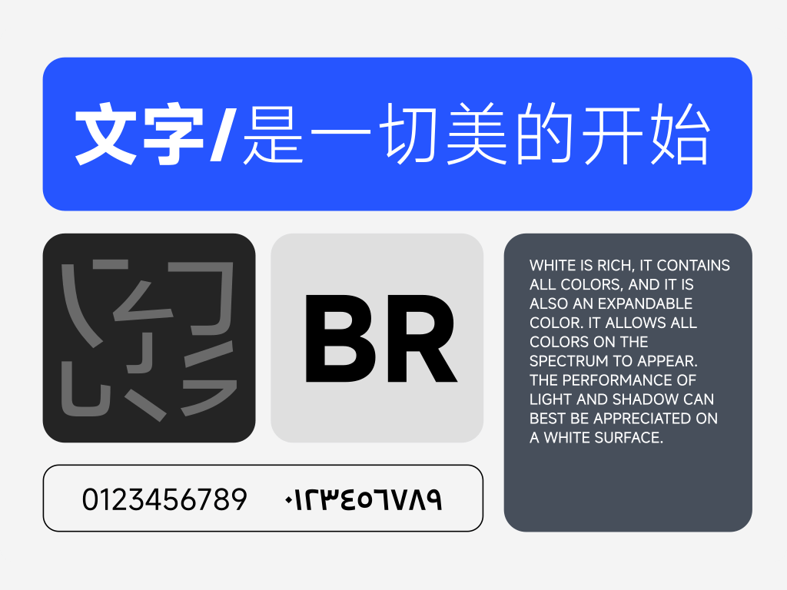

<div align="center">


# MiSans for SiYuan

MiSans typography for your SiYuan interface and notes.


**English** · [简体中文](README_zh_CN.md)

[**Download package**](https://github.com/Chen017/siyuan-plugin-misans/releases/latest) · [MiSans website](https://hyperos.mi.com/font/zh/)

</div>

---

A lightweight community plugin with bundled MiSans Regular and Bold. Enable it to apply the fonts; disable it to remove the plugin styles.

> Maintained by Chen017 and adapted from TCOTC's HarmonyOS font plugin. This project is not affiliated with or endorsed by Xiaomi, Hanyi or SiYuan.



## Features

| Feature | Details |
| --- | --- |
| Interface and notes | Prioritizes MiSans in the global and editor text font stacks |
| Regular and Bold | Normal text starts at weight 400; semantic bold and table cell weight inheritance are preserved |
| Local fonts | Fonts are bundled, with no requests to external font services |
| Current SiYuan support | Handles separate global/editor font stacks and declares publishing resources |
| Clean lifecycle | Background font preloading; stylesheet requests are canceled on timeout or disablement |

SiYuan retains control of emoji and code font variables. Italics are browser-synthesized; missing glyphs use system fallback fonts.

## Installation

**Requires SiYuan 3.8.4 or later.** The plugin is not listed on the SiYuan marketplace.

1. Download **`package.zip`** from [Releases](https://github.com/Chen017/siyuan-plugin-misans/releases/latest), rather than GitHub's generated Source code archives.
2. Extract it into your workspace's `data/plugins/siyuan-plugin-misans/` directory. Make sure `plugin.json` is directly inside that directory.
3. Enable the plugin under Settings → Marketplace → Downloaded → Plugins. Restart SiYuan if the plugin list needs refreshing.

Before updating, disable the plugin and back up its old directory. When migrating from the former package name, remove the old plugin directory and extract this package to `data/plugins/siyuan-plugin-misans/` to avoid enabling two copies.

## Usage notes

- Other global font plugins, themes or CSS snippets may conflict.
- For published pages, allow this plugin in SiYuan's publishing service so visitors can load the declared stylesheet and fonts.
- The upstream `snippetCSS` PDF export mechanism is retained. Actual font embedding and rendering need verification in target clients.
- Reviewed against SiYuan 3.8.8 and upstream plugin 2.3.1, with six lifecycle regression tests passing. Visual testing across all desktop, mobile and browser clients is still pending.

## Development

No npm dependencies are required. Use Node.js and Python 3:

```sh
node --check index.js
node --test tests/*.test.cjs
python3 scripts/package.py
```

The output is `package.zip` at the repository root. CI validates the plugin and uploads a build artifact. GitHub Releases do not automatically submit the plugin to the SiYuan marketplace.

## Fonts and licensing

This plugin uses **MiSans**. Both bundled WOFF files internally report version **4.009**. Copyright belongs to Beijing Xiaomi Mobile Software Co., Ltd. and the respective rights holders; the font name tables credit Xiaomi and Hanyi. Existing WOFF files are unchanged. The historical repository did not preserve the original download archive or conversion history.

- [Official site](https://hyperos.mi.com/font/zh/) · [Official repository](https://github.com/xiaomi-fonts/MiSans)
- [MiSans Font Intellectual Property License Agreement](https://hyperos.mi.com/font-download/MiSans字体知识产权许可协议.pdf)
- Plugin code uses the [MIT License](LICENSE). Fonts have separate terms; see [third-party notices](THIRD_PARTY_NOTICES.md).

## Acknowledgments

Adapted from **[TCOTC/siyuan-ttf-HarmonyOS_Sans_SC-and-Twemoji](https://github.com/TCOTC/siyuan-ttf-HarmonyOS_Sans_SC-and-Twemoji)**, replacing the text fonts. The current font stack, weight inheritance and PDF export support draw on upstream work. Jeffrey Chen's original MIT copyright notice is preserved.

Also thanks to:

- [zuoez02/siyuan-plugin-twitter-emoji](https://github.com/zuoez02/siyuan-plugin-twitter-emoji)
- [Using the same font on mobile and desktop SiYuan](https://ld246.com/article/1705399357823)
- [Official SiYuan plugin sample and guidelines](https://github.com/siyuan-note/plugin-sample)
