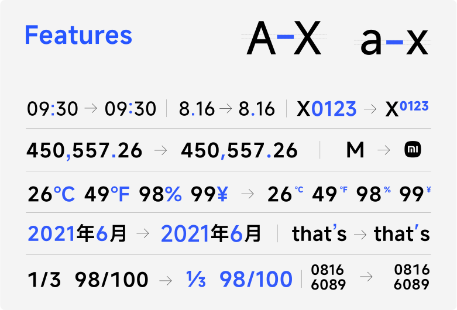
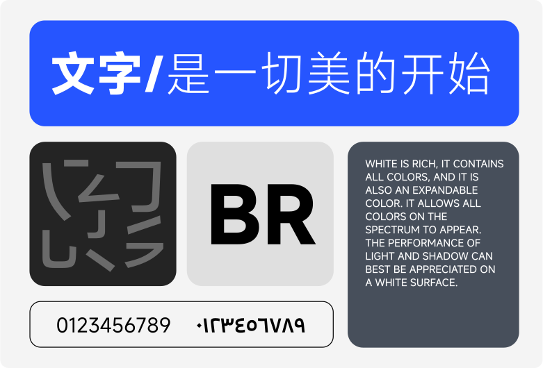
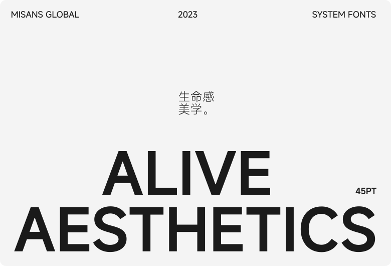
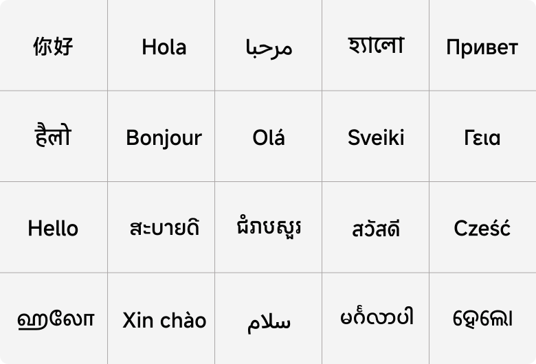

# MiSans

简约清晰，人文易读。

[English](README.md) · **简体中文** · [MiSans 官网](https://hyperos.mi.com/font/zh/)

## 关于 MiSans

MiSans 是小米推出的字体，以简约、清晰、人文、易读和统一的视觉风格为设计原则，让不同语言与文字之间的阅读体验更加协调。

本插件为思源笔记的界面与正文提供 **MiSans 常规和粗体**，让日常记录、阅读与写作拥有统一的字体体验。

## MiSans Global

> 以下介绍摘自 MiSans 官方页面资料。

MiSans Global 是由小米主导，联合蒙纳字库、汉仪字库共同打造的全球语言字体定制项目。这是一个庞大的字体家族，涵盖 20 多种书写系统，支持 600 多种语言，字符数量超过 10 万个。作为 Xiaomi HyperOS 系统默认字体，我们以简约／清晰、人文／易读、统一的视觉风格为基本原则出发，构建多语言信息体验一致性，旨在帮助为 Xiaomi HyperOS 提供互联的通用体验。

| 支持语言 | 字符数量 | 书写系统 |
| :---: | :---: | :---: |
| **600+** | **100,000+** | **20+** |

以上为 MiSans Global 字体家族的整体介绍；本插件内置 MiSans 常规与粗体，并未包含整个 Global 字体家族。

## 无一例外，所有字体都可变

MiSans 官方字体家族提供可变字体，并提供 VF、OTF、TTF、WOFF、WOFF2 等格式，让不同语言、字重与排版场景拥有一致的设计风格。本插件使用其中的常规与粗体 WOFF 文件。

## Hello, World · 你好，世界

从拉丁字母、简体与繁体中文，到希腊文、西里尔文、阿拉伯文、藏文，以及泰文、老挝文、缅甸文、高棉文与多种印度文字，MiSans Global 将不同书写系统融入统一的字体设计之中。

文字，是一切美的开始。

## 致谢

- 感谢 **小米、蒙纳字库与汉仪字库**带来的 MiSans Global 字体家族及官方展示资料。字体与展示素材的权利归原权利人所有。
- 本插件基于 **[TCOTC 的鸿蒙字体插件](https://github.com/TCOTC/siyuan-ttf-HarmonyOS_Sans_SC-and-Twemoji)** 修改，并参考其字体栈、字重继承及 PDF 导出适配。保留原作者 Jeffrey Chen 的 MIT 版权声明。
- 感谢 [zuoez02/siyuan-plugin-twitter-emoji](https://github.com/zuoez02/siyuan-plugin-twitter-emoji)、[思源笔记手机端和电脑端使用同一字体](https://ld246.com/article/1705399357823)及[思源官方插件示例](https://github.com/siyuan-note/plugin-sample)提供的参考。

本插件由 Chen017 社区维护。字体遵循 [MiSans 官方许可协议](https://hyperos.mi.com/font-download/MiSans字体知识产权许可协议.pdf)，插件代码采用 [MIT License](LICENSE)。
